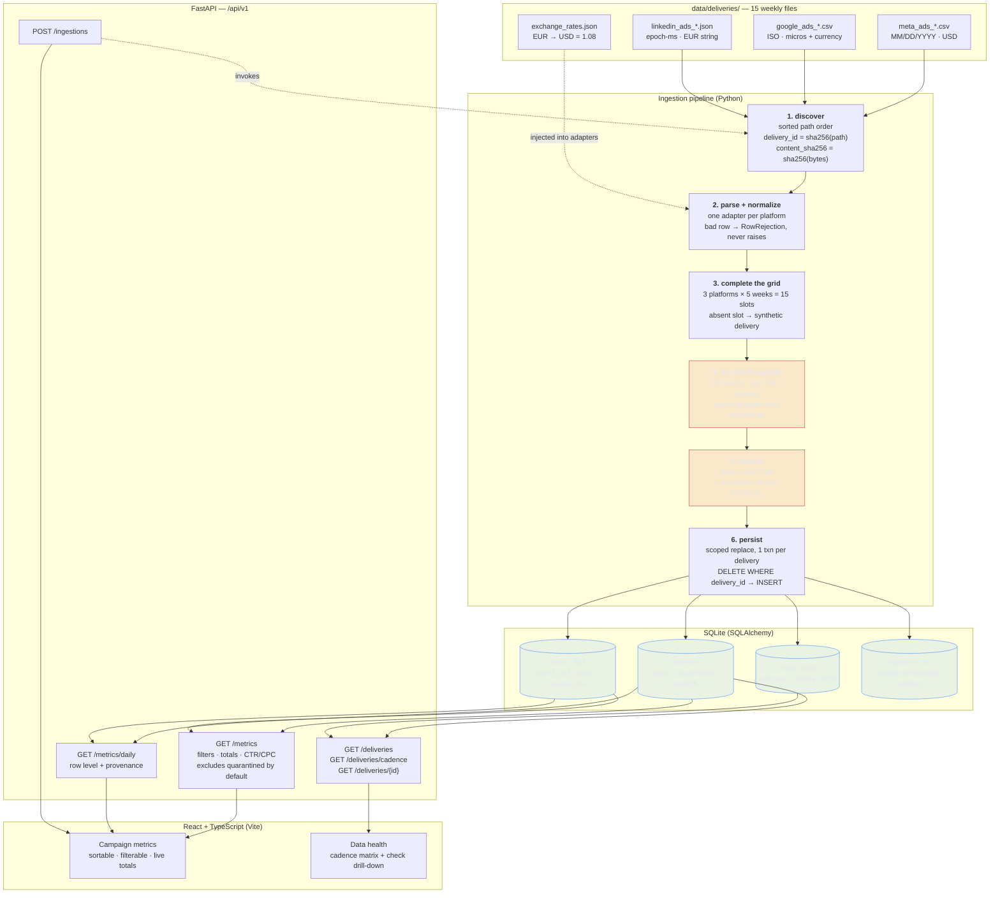
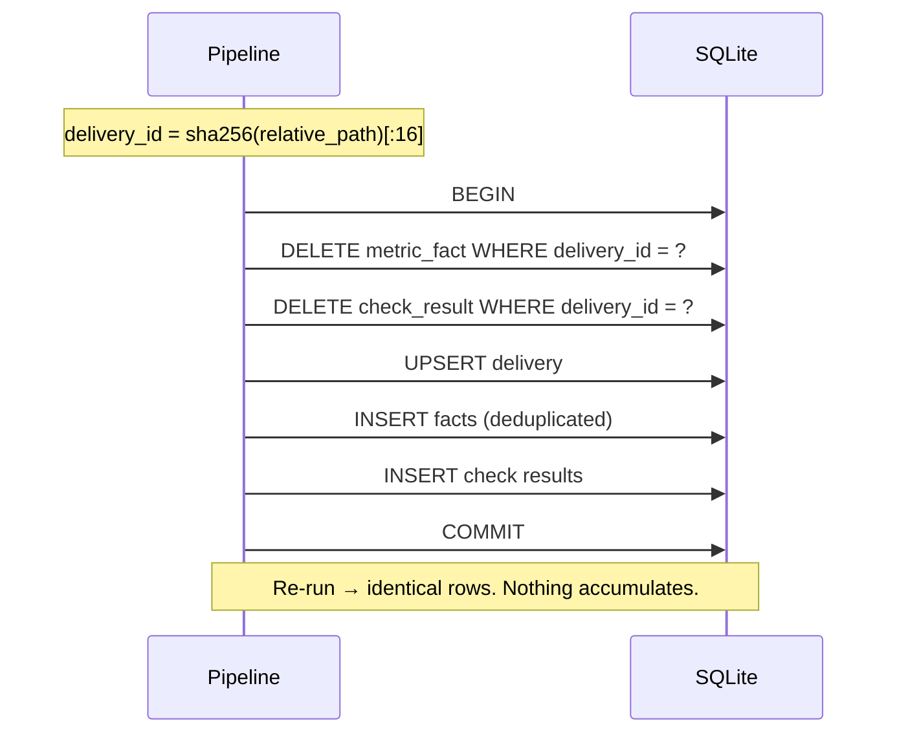

# Architecture

## System overview



## Why the pipeline has two passes

Phase 2 (complete the grid) and phase 4 (checks) both need to see *every*
delivery before any of them can be judged:

| Check | Needs |
|---|---|
| `file.content_duplicate` | every other file's content hash |
| `file.spend_magnitude` | the platform's median across its other weeks |
| `delivery.present` | the full expected platform × week grid |

A single streaming pass would make a verdict depend on how far through the
directory we happened to be — the same data would grade differently on
different runs. So nothing is written until every file has been parsed.

## Idempotency (NFR-1)



Three decisions make this hold:

1. **`delivery_id` from the path, not the content.** Path identity means "the
   same delivery slot", so a corrected re-send under the same name *replaces*
   rather than double-counts. The content hash is a separate column used only
   by the duplicate check.
2. **Scoped delete-then-insert, not upsert.** An upsert would leave stale rows
   behind if a re-delivery contained *fewer* rows than before.
3. **Sorted discovery order.** Two provided files are byte-identical; the one
   processed first is treated as the original. Filesystem order is not stable
   across machines, so discovery sorts by path and the verdict never flips.

One transaction *per delivery*, not per run: a failure on delivery 12 must not
roll back the eleven that succeeded (NFR-2).

## Error isolation (NFR-2)

Three nested boundaries, each degrading rather than aborting:

```
row     adapter.normalize() RETURNS RowRejection      → row excluded, run continues
file    FileParseError caught in _context_for_file()  → delivery graded, run continues
check   exception caught in run_checks()              → recorded as SKIP, other checks continue
```

A crashing check is recorded as **skip**, never **fail** — a check that did not
examine the data must not be allowed to condemn it.

## Traceability (NFR-3)

Every stored fact carries `delivery_id`, `source_line` and `campaign_raw`, so
any figure on screen resolves to a file, a line, and the exact string the
platform sent. `GET /api/v1/metrics/daily` exposes that chain over HTTP.

```
$48,709.02 total
  └─ 13 contributing deliveries (3 quarantined and excluded)
       └─ metric_fact rows, each with delivery_id + source_line
            └─ delivery.source_path + content_sha256
                 └─ the original file in data/deliveries/, unmodified
```
